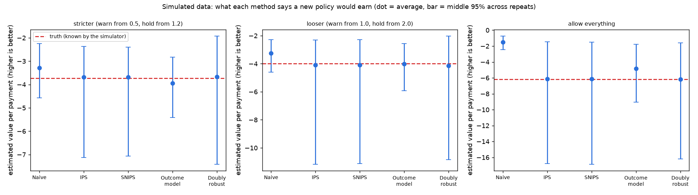

# Decision Lab evaluation (generated; do not edit by hand)

**All numbers on this page come from a simulator, not from real customers.** Real inputs: payment amounts follow the real ULB card data (log mean 3.005, sd 1.87). Everything else (scam rate, how well the risk score separates scams, how coached victims react, analyst catch rates, friction costs) is an assumption, listed below and varied in the last section.

The question: a team has logged payments handled by an old policy. How well can it predict, from that log alone, what a NEW policy would have earned (money lost to scams plus the cost of bothering good customers)? The simulator knows the true answer, so each method can be graded. 'Value per payment' is minus (average loss and friction cost); closer to zero is better.

Selective labels: a payment that was held never reveals whether it was a scam, so the log only shows outcomes for some payments. This is why simple comparisons mislead.

Setup: 200 repeats, 20,000 payments each, logging policy holds from score 1.6 and warns from 0.8, plus 10% random exploration so every action has a known chance.

## Grading each method against the truth (base assumptions)

### New policy: stricter (warn from 0.5, hold from 1.2)

True value per payment: **-3.73**

| Method | Average estimate | Bias | Typical error (RMSE) | Its 95% interval contains the truth | Average interval half-width |
|---|---|---|---|---|---|
| Naive (compare matching rows) | -3.28 | +0.45 | 0.76 | 75% | 1.12 |
| Inverse propensity (IPS) | -3.69 | +0.04 | 1.24 | 82% | 1.55 |
| Self-normalised IPS | -3.68 | +0.05 | 1.24 | 80% | 1.54 |
| Outcome model only | -3.94 | -0.21 | 0.71 | 41% | 0.40 |
| Doubly robust | -3.68 | +0.05 | 1.31 | 88% | 1.89 |

### New policy: looser (warn from 1.0, hold from 2.0)

True value per payment: **-3.98**

| Method | Average estimate | Bias | Typical error (RMSE) | Its 95% interval contains the truth | Average interval half-width |
|---|---|---|---|---|---|
| Naive (compare matching rows) | -3.26 | +0.72 | 0.96 | 62% | 1.14 |
| Inverse propensity (IPS) | -4.10 | -0.11 | 2.15 | 72% | 2.54 |
| Self-normalised IPS | -4.10 | -0.12 | 2.15 | 73% | 2.53 |
| Outcome model only | -4.02 | -0.03 | 1.00 | 36% | 0.42 |
| Doubly robust | -4.14 | -0.16 | 2.01 | 84% | 2.54 |

### New policy: allow everything

True value per payment: **-6.16**

| Method | Average estimate | Bias | Typical error (RMSE) | Its 95% interval contains the truth | Average interval half-width |
|---|---|---|---|---|---|
| Naive (compare matching rows) | -1.48 | +4.68 | 4.70 | 0% | 0.84 |
| Inverse propensity (IPS) | -6.14 | +0.02 | 4.23 | 68% | 5.99 |
| Self-normalised IPS | -6.12 | +0.05 | 4.18 | 68% | 5.94 |
| Outcome model only | -4.84 | +1.32 | 2.47 | 8% | 0.35 |
| Doubly robust | -6.16 | +0.00 | 3.84 | 69% | 5.61 |

Reading (from the tables above): the naive comparison is fine when the new policy is close to the old one and wrong when it is not: the further the new policy is from the logged one, the larger the error, and for 'allow everything' it is off by several times the true loss and never contains the truth. The outcome-model-only method has tiny intervals that contain the truth only about 8% to 41% of the time: it is overconfident. IPS and doubly robust are close to unbiased, but their intervals still miss the truth more often than the promised 5% (they contain it 68% to 88% of the time here) because a few large payments dominate the average, so normal-approximation intervals are too narrow. Doubly robust had the best coverage and, for the looser and allow-everything policies, the smallest error of the corrected methods. Note that the outcome-model-only method has the smallest typical error in several rows, but it is biased and cannot tell you how wrong it is, which is what a decision needs.



## Trade-off between stopping scams and bothering good customers (truth from the simulator)

| Hold from score | Warn from score | Scam money stopped | Good payments warned | Good payments held | Value per payment |
|---|---|---|---|---|---|
| 0.4 | 0.0 | 65% | 16% | 34% | -4.74 |
| 0.8 | 0.4 | 62% | 13% | 21% | -3.98 |
| 1.2 | 0.8 | 55% | 10% | 11% | -3.66 |
| 1.6 | 1.2 | 46% | 6% | 5% | -3.76 |
| 2.0 | 1.6 | 35% | 3% | 2% | -4.12 |
| 2.4 | 2.0 | 24% | 1% | 1% | -4.68 |
| 3.0 | 2.6 | 11% | 0% | 0% | -5.42 |
| 99.0 | 98.6 | 0% | 0% | 0% | -6.04 |

## Which kinds of scam does the logging policy stop? (truth from the simulator; hold from 1.6, warn from 0.8)

| Kind of scam | Chance the victim is coached | Share of all scams | Scam money stopped | Held | Warned | Allowed |
|---|---|---|---|---|---|---|
| impersonation | 90% | 35% | 35% | 58% | 25% | 17% |
| romance | 50% | 25% | 51% | 57% | 27% | 17% |
| investment | 60% | 25% | 49% | 58% | 26% | 16% |
| account takeover | 0% | 15% | 72% | 58% | 26% | 16% |

## Do the conclusions survive different assumptions?

Each row repeats the experiment 60 times under different assumptions. Shown for the 'stricter' policy: how often each method's 95% interval contains the truth, and its bias.

| Assumption set | Truth | Naive: covers / bias | IPS: covers / bias | Outcome model: covers / bias | Doubly robust: covers / bias |
|---|---|---|---|---|---|
| base assumptions | -3.73 | 75% / +0.45 | 82% / +0.04 | 41% / -0.21 | 88% / +0.05 |
| rarer scams (0.5% instead of 2%) | -1.63 | 57% / +0.37 | 85% / -0.10 | 30% / -0.13 | 87% / -0.04 |
| weaker risk score (gap 1.0 instead of 1.8) | -4.91 | 82% / +0.52 | 87% / -0.41 | 47% / -0.10 | 88% / -0.33 |
| less exploration (5% instead of 10%) | -3.73 | 83% / +0.32 | 83% / -0.31 | 37% / -0.59 | 93% / -0.32 |

## Assumptions used (base)

```
{
 "scam_rate": 0.02,
 "log_amount_mean": 3.005,
 "log_amount_sd": 1.87,
 "scam_log_amount_shift": 1.2,
 "score_separation": 1.8,
 "archetype_share": [
  0.35,
  0.25,
  0.25,
  0.15
 ],
 "coaching_by_archetype": [
  0.9,
  0.5,
  0.6,
  0.0
 ],
 "warn_ignore_uncoached": 0.25,
 "hold_catch_uncoached": 0.9,
 "hold_catch_coached": 0.55,
 "legit_abandon_warn": 0.02,
 "legit_abandon_hold": 0.12,
 "abandon_cost": 20.0,
 "review_cost": 5.0,
 "amount_cap": 5000.0,
 "epsilon": 0.1
}
```

## Limits (read these)

- A simulator can only prove a method works on worlds like the simulator. The point is to catch methods that fail even here, and to show how large their errors are.
- Coverage is measured over a finite number of repeats, so each percentage has roughly +/- 7 points of noise at 200 repeats and +/- 13 at 60.
- Payment amounts are capped (an assumption). Without a cap, a few huge payments dominate the average and every method fails at this sample size, which is itself a real-world warning.
- Interval type: normal approximation, not bootstrap.
